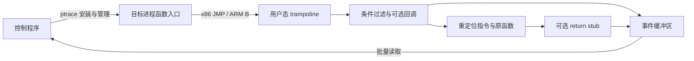

# LUDP：轻量级用户态动态探针

Lightweight Dynamic Probe for User Space

> 2026 年全国大学生计算机系统能力大赛 · 操作系统设计赛 · 西北区域赛
> 赛题类型：工程型；难度：A；实现平台：Linux x86-64 / System V AMD64 ABI 与 ARM64 / AAPCS64。

参赛队伍：**在线求偶等她入队**。成员：刘志钰、迮泳瑞、张向前。

本文按设计赛道文档大纲组织。技术细节统一收录于 [文档索引](docs/README.md)，可复现演示见 [演示指南](docs/demo.md)。

## 1. 目标描述

LUDP 利用 `ptrace` 在目标进程中部署探针代码，将函数入口改写为用户态跳转，实现动态库函数探测、参数采集、返回值捕获与探针管理。内置采集路径在命中时不通过 `int3`/trap 进入内核；安装、线程协调和回收发生在控制阶段。

项目交付 C 静态库、可运行示例、功能验证、百万次 `getpid` 基准及自动生成的验证报告。提供 x86-64 与 ARM64 两套后端，以及 F1–F7、A2/A4/A5 的专项验证；A3 提供时间换算、perf-script 风格输出和真实 ftrace 事件合流流程。提交 `3ffd736` 已通过双架构原生 full / UBSan 检查；本轮新增清理优化、独立 exec/ASLR 验证及严格内核事件检查，需重新取得同提交的双架构结果，详见 [测试规范](docs/testing.md)。

| 目标 | 验收方式 |
| --- | --- |
| F1–F7 基础功能 | 专项测试核验入口跳转、六参数、返回值、清理、开关、多探针及多线程 |
| 单次额外开销 `<1000 ns` | entry、entry+return 分别与同轮无探针基线相减，取增量中位数 |
| 插入 / 清理延迟 `<10 ms` | 每轮插入和完整清理最大耗时；完整清理覆盖 remove、入口校验和 detach |
| 无探针触发时零开销 | 未安装补丁时不增加函数入口执行路径；测量差值保留调度噪声 |
| 文档完整与演示可复现 | 一键执行、逐步日志、明确判定、环境与源码身份、原始数据 |

这些是目标与检查口径，不代表任意环境已达标。[测试规范](docs/testing.md) 说明统计方法、完整清理门禁与支持范围；历史报告按原版本口径保留。

## 2. 比赛题目分析和相关资料调研

赛题由龙蜥社区、阿里云计算有限公司维护，要求降低传统内核 uprobe 命中时的上下文切换成本，并增强用户态探针表达能力。系统需要同时解决指令重定位、ABI 现场保持、动态链接与 ASLR、返回地址管理、多线程和资源回收等问题。

| 资料 | 对本项目的参考价值 |
| --- | --- |
| [Linux Uprobe tracer](https://docs.kernel.org/trace/uprobetracer.html) | 理解内核用户态探针及对照测量对象 |
| [Linux Kprobes](https://docs.kernel.org/trace/kprobes.html) | 理解入口/返回探针、指令处理与运行约束 |
| [ptrace(2)](https://man7.org/linux/man-pages/man2/ptrace.2.html) | 进程附加、停止状态、寄存器与线程事件控制 |
| [Libcare](https://github.com/cloudlinux/libcare) | 运行中用户态代码补丁的工程思路 |
| [Frida](https://frida.re/) | 动态插桩与目标进程内执行逻辑 |
| [bpftime](https://eunomia.dev/zh/blogs/bpftime/) | 用户态可观测性和低开销采集思路 |

本项目选择“控制阶段 ptrace + 命中阶段用户态 trampoline”的方案。文中参考资料用于说明设计依据，不构成对其他项目的性能优劣结论。赛题的 1500–3000 ns uprobe 参考范围不作为本项目实测数据。

## 3. 系统框架设计



| 模块 | 实现文件 | 职责 |
| --- | --- | --- |
| 进程控制与事件消费 | `ludp.c` | 线程协调、远程内存访问、资源管理及事件读取 |
| 探针管理 | `probes.c` | 注册表、同地址入口链、开关和配置更新 |
| 符号与指令处理 | `elf.c`、`x86dec.c`、`aarch64.c` | ELF/ASLR 定位、入口解码和重定位 |
| 目标进程执行路径 | `trampoline.S`、`aarch64_trampoline.S` | 参数采集、返回探针、现场保护和回调 |
| 公共接口 | `ludp.h` | C API、事件及探针配置结构 |
| 演示与评测 | `scripts/run_demo.py`、`benchmark.py` | 顺序执行、结果校验及证据保存 |

x86-64 入口使用 5 字节 `JMP rel32`，ARM64 使用 4 字节 `B`；被覆盖指令按架构规则重定位。返回探针通过每次调用独立的 return stub 采集 `RAX/RDX/XMM0` 或 `X0/X1/V0`，以 `call_id` 配对。事件缓冲支持多生产者、单消费者，溢出与返回记录不足均显式计数。

安装、开关、更新和清理要求应用协调的安全点；单个 `ludp_ctx` 只支持一个控制线程和一个事件消费者。返回探针不支持跨帧异常展开、`longjmp`、换栈、CET shadow stack 或 ARM GCS；A4 不保存 AMX tile、SVE/SME 扩展状态。完整说明见 [系统设计](docs/architecture.md)、[API](docs/api.md) 和 [支持范围与限制](docs/limitations.md)。

## 4. 开发计划

以下按工程交付阶段整理当前状态，并非补写历史上未留存的原始排期。

| 阶段 | 交付目标 | 当前状态与出口条件 |
| --- | --- | --- |
| 基础路径 | F1–F3、指令解码、参数与返回值 | 已有实现；通过对应集成与 ABI 用例 |
| 生命周期与并发 | F4–F7、资源回收、信号与线程协调 | 已有实现；验证入口恢复、映射回收和多探针命中 |
| 进阶与加固 | A2–A5、API/ELF/向量状态加固 | 已有实现；新增 A3 真实合流与独立 exec 用例，待新版双架构复测 |
| 文档与演示 | 正式文档、一键 demo、量化证据 | 本轮交付；执行命令并保存真实报告 |
| 正式提交验证 | 完整三组对照、真实合流及原始报告 | CI full 强制两项内核实测；以本轮提交的新报告判定 |
| 多架构扩展 | A1/ARM64 后端与独立验收 | `3ffd736` 的双架构原生 full / UBSan 四个作业均通过 |

## 5. 比赛过程中的重要进展

下表来自仓库 Git 提交记录；日期是记录中的提交日期，不推断未留存的比赛活动。

| 日期 | 进展 | 提交依据 |
| --- | --- | --- |
| 2026-11-21 | 完善 F1–F3 基础功能 | `ff0e8b6` |
| 2026-11-24 | 加入清理与运行期开关 | `3804e1c` |
| 2026-11-25 | 整合 F1–F7，增加正确性与性能验收 | `575dc0b`、`19eb240` |
| 2026-11-25 | 增加 A2/A3/A5 及专项测试 | `07ee58d`、`231fffb` |
| 2026-11-25 | 增加 A4 目标进程回调及现场恢复 | `e0df139`、`5ca63df` |
| 2026-11-25 | 加固线程事务、ELF、向量状态，增加 UBSan | `36538a4`、`8a5343c`、`f04615e` |
| 2026-11-27 | 完成文档、演示与 A1 双架构原生验证 | `3ffd736`；Actions 运行 `45946335169` |

关键改进的原因和验证依据见 [工程改进记录](docs/engineering.md)。双架构原始结果固定保存在 [验证报告归档](docs/archive/README.md)，每份结论均对应其记录的提交和运行环境。

## 6. 系统测试情况

### 6.1 功能与正确性

“已提供用例”表示源码中有对应检查，具体环境的通过状态以该次报告为准。

| 赛题项 | 当前能力 | 验证程序 |
| --- | --- | --- |
| F1 / F2 / F3 | 动态库入口跳转、六个 INTEGER 参数、返回寄存器及调用配对 | `probe_demo`、`probe_abi_validation` |
| F4 / F5 | 入口恢复、映射回收、在途调用保护、动态开关 | `probe_lifecycle_validation` |
| F6 | ≥16 个不同地址；80 项同地址入口链压力用例 | `multiprobe_validation` |
| F7 | 多线程跟踪、并发采集、信号转发；变更要求安全点 | `thread_signal_validation`、`probe_abi_validation` |
| A1 | x86-64 / ARM64 后端；`3ffd736` 双架构原生验证通过 | 双架构 CI：同一套完整验证、UBSan 与性能基准 |
| A2 / A5 | 条件过滤、安全点配置更新及错误配置拒绝 | `probe_extensions_validation` |
| A3 | 时间换算、TID 映射和真实 ftrace 合流；新版原生结果待取得 | `event_stream_demo`、`event_merge_demo.py` |
| A4 | 目标进程回调和上下文恢复 | `callback_validation` |
| 通用正确性 | 指令解码、API/ELF、独立 exec/ASLR、UBSan | `instruction_validation`、`api_contract_validation`、`aslr_pie_validation`、CI |

### 6.2 构建和一键演示

环境要求：Linux x86-64 或 ARM64、GCC、GNU make、glibc、Python 3.9+（含时区数据），允许父进程 `ptrace` 自己启动的子进程；Python 无第三方包依赖。默认事件环约占 544 MiB 虚拟空间，基准需要足够内存，见 [测试规范](docs/testing.md)。

在仓库根目录执行：

```bash
# 基础演示：自动构建，展示 F1–F3，并验证 F4–F7
python3 scripts/run_demo.py

# 完整演示：正确性、进阶功能、五轮百万次 getpid 基准
python3 scripts/run_demo.py --full

# 严格验收：内核 uprobe 对照、A3 真实合流均不可缺失
python3 scripts/run_demo.py --full --require-kernel --require-merge
```

每次演示在 `artifacts/demo/` 下生成独立目录，包含步骤日志、`summary.json` 和功能、正确性与性能验证报告；完整模式另保存 getpid 性能基准和 A3 事件合流专项报告。主报告逐项列出 F1–F7、A1–A5。F1–F3 展示真实入口字节、参数 `[1,2,3,4,5,6]`、整数返回值 `183`、浮点返回值 `4.00` 及事件配对。失败返回非零退出码，跳过项明确为 `SKIP`。

[演示指南](docs/demo.md) 提供运行步骤、输出解释、判定条件和结果复现方法。与 `Proj40/` 同级的 [test 功能包](test/README.md) 负责 GitHub 结果同步：`python3 -m test sync --wait`。最新结果保存在 `test/results/`，下一次同步仅替换该结果目录，包代码和说明保留。

### 6.3 独立验收与性能口径

```bash
make -C Proj40 -j4
make -C Proj40 check
python3 Proj40/evaluate.py --rounds 5 --iterations 1000000 \
  --output artifacts/validation
```

基准逐轮测量 baseline、inert、entry、entry+return 和可用的内核 uprobe。开销按“同轮相减再取中位数”计算；entry+return 按一次函数调用计，包含两条事件。报告保留最大插入/移除、attach/detach、丢失计数和原始样本。

普通模式的内核组不可用时保留 `SKIP`，不补写参考数值或加速比。新版门禁纳入完整清理 `<10 ms`，但不覆盖所有线程规模或任意 A4 回调开销。CI full 在临时 Runner 中以所需权限执行严格模式，内核对照或真实合流缺失均失败。完整证据矩阵、统计公式和待补验证项见 [测试与性能评估](docs/testing.md)。CI 配置见 [ci.yml](.github/workflows/ci.yml)。

### 6.4 2026-11-27 双架构原生验证快照

GitHub Actions 运行 `45946335169` 对提交 `3ffd7368af3ac1ba1df4385ca4bf1f342b858903` 执行了四个作业：x86_64 / ARM64 的 full 与 UBSan 均通过。两种架构的完整模式分别通过八个验证程序和 `probe_demo`，并以 GCC 13.3.0、`-O2 -Werror` 完成 5 轮、每轮 1,000,000 次 `getpid` 基准：

| 架构 | 模式 | 单次调用增量中位数 | 最大插入 | 最大移除 | 最大 detach |
| --- | --- | ---: | ---: | ---: | ---: |
| x86_64 | 入口探针 | 79.976 ns | 1.171 ms | 1.117 ms | 14.880 ms |
| x86_64 | 入口 + 返回探针 | 170.074 ns | 4.712 ms | 3.503 ms | 24.482 ms |
| ARM64 | 入口探针 | 68.663 ns | 2.824 ms | 3.285 ms | 12.735 ms |
| ARM64 | 入口 + 返回探针 | 155.623 ns | 6.138 ms | 5.644 ms | 21.206 ms |

该历史版本的用户态探针开销及插入/移除门禁通过；完整 detach 超过 10 ms，当时未纳入门禁。内核 uprobe 均因 `Permission denied` 为 `SKIP`，三组对照未完成。本轮针对这些问题修改实现和验收流程，上表不代表修改后的成绩。数据来自不同的共享 Runner，不能据此推导架构优劣或任意设备上的性能。

完整作业报告、环境、源码指纹及原始性能样本见 [验证报告归档](docs/archive/README.md)。归档保留下载文件原始内容；结论限定于该提交、相应环境与已执行的用例。

### 6.5 A1 集成验证

归档中的原生 x86_64 和 ARM64 报告来自同一次 Actions 运行、同一提交，构成该版本的 A1 双架构验证证据。交叉编译和 QEMU 执行仅作为开发检查，模拟耗时不作为原生性能验收数据。

后续提交仍需重新运行 [GitHub Actions](.github/workflows/ci.yml)，再执行 `python3 -m test sync --wait` 下载当前分支最新结果。`test/results/report.md` 与 `test/results/latest.json` 记录提交、架构、作业结论及缺失项；它们是滚动结果，不能替代 `docs/archive/` 中固定提交的报告。

## 7. 遇到的主要问题和解决方法

| 问题 | 处理方法 | 验证或保留边界 |
| --- | --- | --- |
| 覆盖入口可能拆分或改变原指令语义 | 完整解码与重定位；拒绝不支持的编码 | 解码负向用例及真实函数探测 |
| 信号停止与 syscall-stop 混淆 | TRACESYSGOOD、逐线程停止状态、暂存并转发真实信号 | 信号重入及暂停竞争回归 |
| PIE/无 section-header ELF 解析 | 结合映射与动态段定位符号 | ELF/API 测试；新增 8 次独立 exec 的双映射地址变化验证 |
| 回调破坏扩展向量现场 | XSAVE/XRSTOR；旧 CPU 回退 FXSAVE | AVX 条件回归；不支持 AMX tile |
| 清理时存在在途返回或回调 | 忙时拒绝、等待安全点后重试 | F4/A4 专项测试 |
| 历史报告容易误作当前成绩 | 归档原始数据；每次 demo 建独立目录并记录源码身份 | 按该次日志及退出码复核 |
| 完整清理延迟与内核对照缺项 | 优化 ptrace 等待、建议事件环使用透明大页；完整清理与真实内核采集进入门禁 | 保留慢样本与错误原因，由新版双架构 CI 复测 |

仍需遵守应用安全点、单控制线程等边界。`PTRACE_O_EXITKILL` 意味着控制进程异常退出可能导致被跟踪目标终止；不应宣称故障后无影响。详细故障处理见 [支持范围与限制](docs/limitations.md)。

## 8. 分工和协作

队伍名称：**在线求偶等她入队**；成员：**刘志钰、迮泳瑞、张向前**。以下作为后续开发、验证和维护的职责安排，历史贡献以实际提交与团队记录为准。

| 成员 | 主要职责 | 协作接口与交付 |
| --- | --- | --- |
| 刘志钰 | 进程控制、探针生命周期与整体集成 | `ludp.c` / `probes.c`，维护状态、错误契约与版本集成 |
| 迮泳瑞 | 指令、符号解析与 ABI 现场 | `x86dec.c` / `aarch64.c` / `elf.c` / 两套 trampoline，维护重定位和寄存器保护 |
| 张向前 | 正确性验证、性能评测与演示文档 | `*_validation.c` / 评测脚本 / `docs/`，维护验证报告与演示说明 |

模块负责人提交实现与对应测试，跨模块修改由相关成员交叉核对；集成时检查文档、测试矩阵与 CI 结果是否同步。每轮集成统一记录系统设计、适用范围、源码版本和实测结果，依据失败日志分配问题并复核修复。

## 9. 提交仓库目录和文件描述

```text
.
├── README.md                 # 设计赛道十章项目说明与评审入口
├── Proj40/                   # C/汇编核心库、示例、测试与评测程序
│   ├── ludp.h                # 公共 API
│   ├── Makefile              # 构建、测试与演示目标
│   ├── probe_demo.c          # 真实动态库函数探针演示
│   └── README.md             # 源码文件职责
├── scripts/                  # 一键验证、A3 真实事件采集与合流
│   ├── run_demo.py
│   ├── event_merge_demo.py
│   └── merge_events.py
├── docs/                     # 需求、设计、接口、测试、限制与演示
│   └── archive/              # 固定提交的验证报告
├── test/                     # GitHub 结果同步与离线验证功能包
│   ├── __main__.py           # python3 -m test 命令入口
│   ├── sync_ci_results.py    # 运行查询、下载与结果替换
│   ├── ci_results_validation.py # 同步逻辑离线验证
│   └── results/              # 最新一轮结果，仅此目录在同步后替换
├── artifacts/                # 本地生成的演示/评测结果，不纳入版本管理
└── .github/workflows/ci.yml  # 原生 x86-64 / ARM64 CI 与 UBSan
```

正式文档集中于 [docs](docs/README.md)。临时二进制和缓存可重新生成；本地结果写入 `artifacts/`，GitHub 最新结果写入 `test/results/`；固定验证报告保存在 `docs/archive/`，不会随最新结果同步而覆盖。公共头文件声明 MIT，仓库尚未提供完整的 LICENSE 文件。

## 10. 比赛收获

从现有实现和测试可以归纳出以下工程经验：

1. 用户态动态探针的正确性依赖指令、ABI、信号和线程状态的共同约束；功能演示必须配合现场恢复与错误路径测试。
2. 低开销设计需要区分控制阶段和命中阶段，也需要明确事件字段、样本规模和资源占用；单个耗时数字不能代替完整测量条件。
3. 可复现交付需要建立“需求—实现—测试—原始证据”的对应关系，明确历史结果、当前结果、跳过项和尚未覆盖的场景。

这些经验形成了后续维护的工作方法：先定义可验证的需求和接口，再实现与测试，最后用一致的文档和原始数据说明结果。
